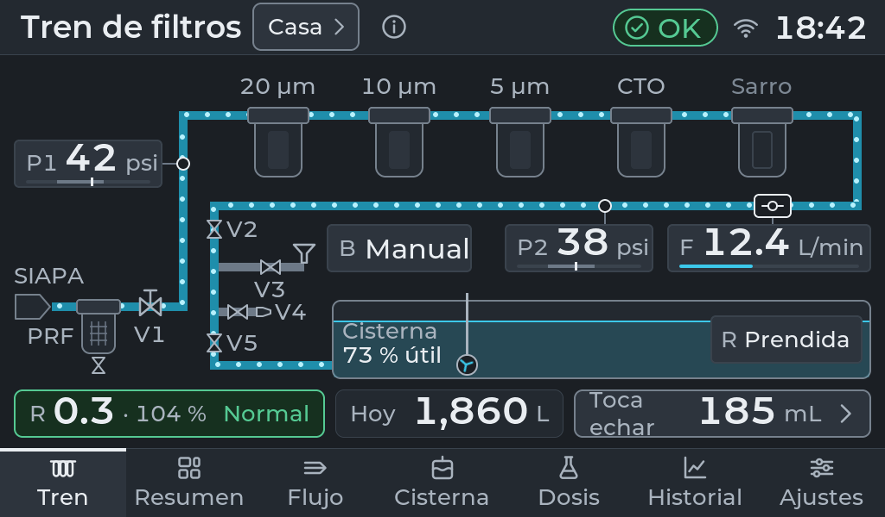
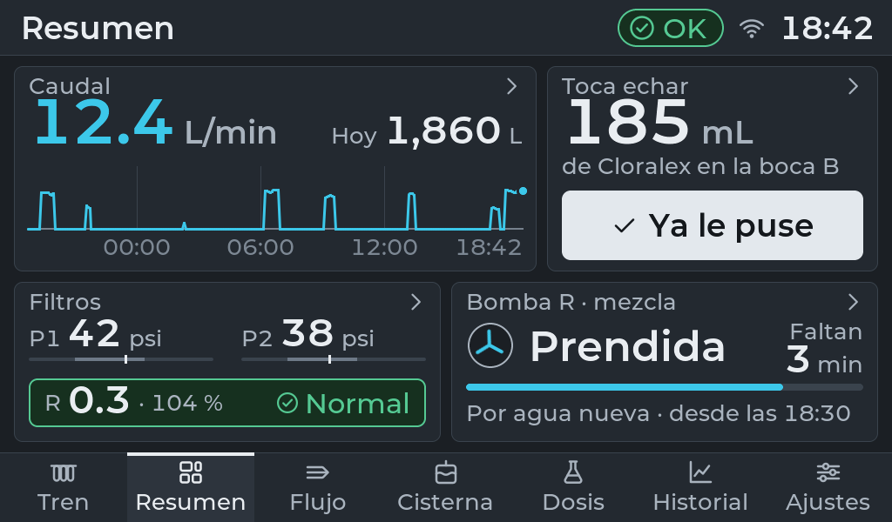
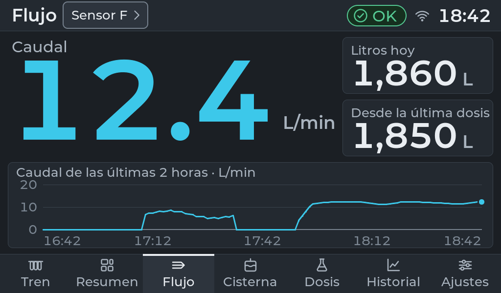
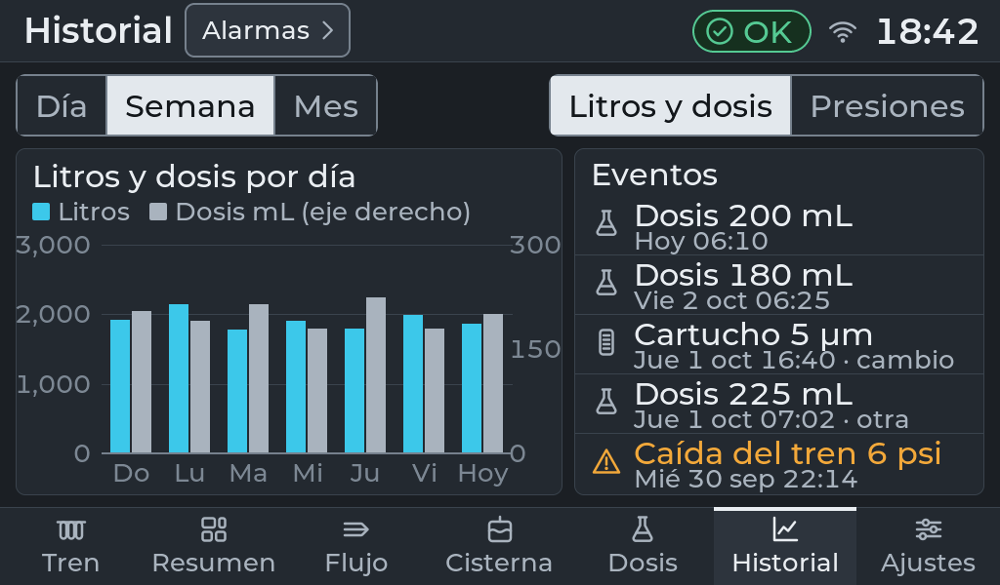
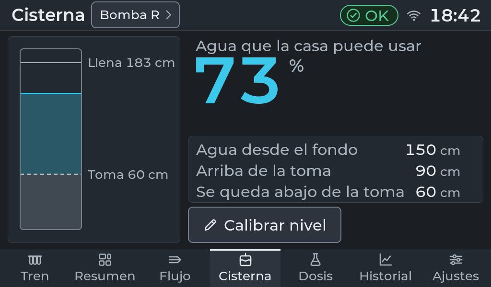
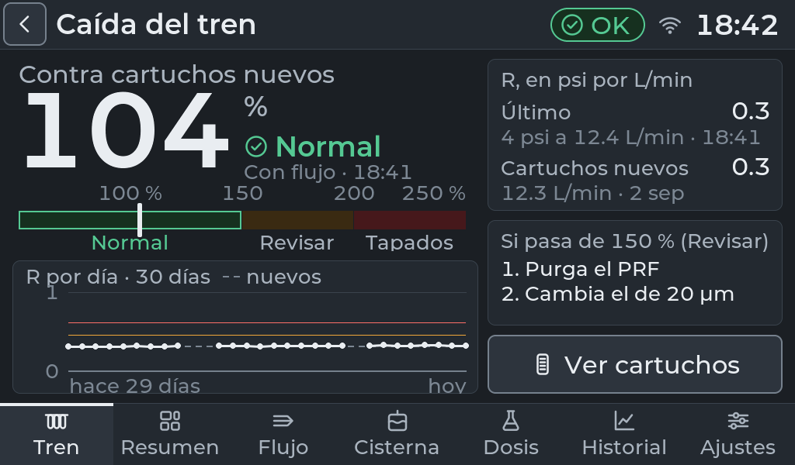
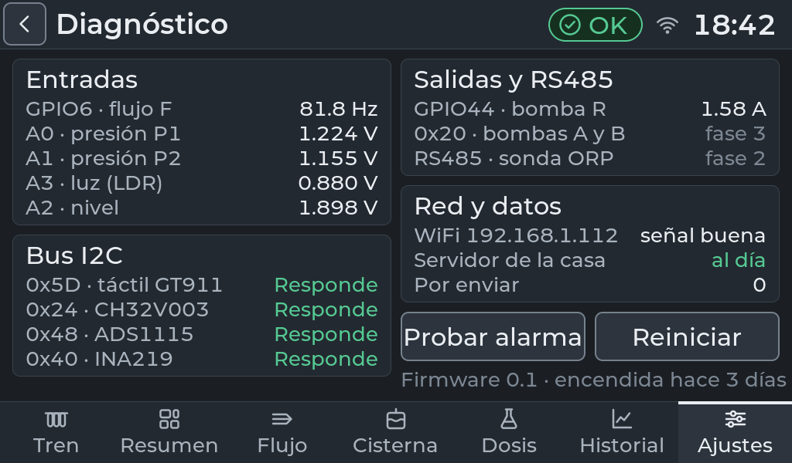
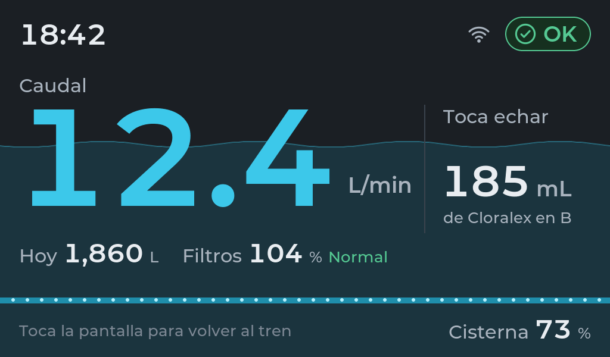
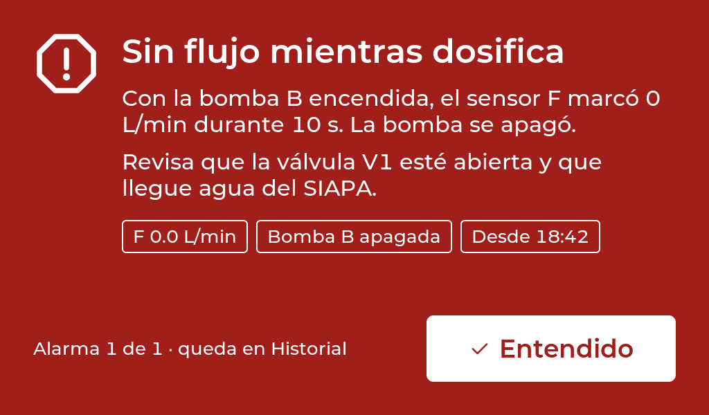

# Home Water SCADA

Touch HMI and controller for the water system of a house in Zapopan, Mexico: a
5-cartridge filter train fed by the city supply (SIAPA), a 10 m³ cistern, and
the chlorine that keeps the cistern water from going bad.

It runs on a Waveshare **ESP32-S3-Touch-LCD-7B** (1024 x 600, GT911 touch) with
**ESP-IDF v6.1** and **LVGL 9.6**, written in **C++17**. The same `core/` and `ui/`
code runs in a desktop simulator (SDL, Mac and Linux), so every screen can be
developed and checked on a computer before it goes to the board.



Live P&ID of the train: supply, prefilter, the five cartridges, pressures P1/P2,
flow F, the cistern level and the mixing pump. The UI is in Spanish, like the
rest of the house.

## What it does

- **Meters the water**: flow and daily liters from a hall-effect flow sensor,
  P1/P2 pressure before and after the train, and the cistern level from a
  4-20 mA submersible transmitter.
- **Tells you how much chlorine to add**: mL since the last dose from the metered
  volume, with a one-tap "already added" and a history of doses.
- **Knows when the cartridges are clogging**: R = (P1 − P2) / F against the
  reference saved with new cartridges, so the verdict does not move with the
  city's pressure (fixed psi thresholds flagged new cartridges as clogged).
- **Runs the cistern mixing pump**: 45 min after each dose and 15 min per 1,000 L
  of new water, supervised by an INA219 (no 12 V, low level, stalled pump).
- **Alarms, events and history** on the screen: per-hour and per-day charts of
  liters, doses and pressures; full-screen alarms that have to be acknowledged.
- **Telemetry** to a home server (VictoriaMetrics, Influx line protocol) every
  10 s, with a one-day ring buffer in PSRAM when the WiFi is down.
- **Signed OTA over WiFi**: push a `.bin` from any computer or let the board pull
  it from a URL; a new version that does not come back online in 5 min rolls
  back on its own, and after an update the board runs a self-check and shows it.
- **Finds its own sensors**: P1, P2, level and LDR are detected from their
  readings; a sensor that goes quiet shows "Sin señal" instead of a false alarm.
- Everything persists in NVS, so a power cut or an update picks up where it was.

## Screens

| | |
|---|---|
|  Summary: today at a glance |  Flow: live L/min and the last two hours |
|  History: liters, doses and events per day |  Cistern: usable water above the pump intake |
|  Clogging: R against new cartridges, 30 days |  Diagnostics: every input, bus and output |
|  Idle screen, readable from the hallway |  Full-screen alarm until acknowledged |

22 screens in all: the 7 tabs, their detail views, cartridge service, bucket test
for calibrating the flow sensor, level calibration, spares and a P&ID legend.

## Hardware

One microcontroller, the ESP32-S3 on the display board, plus a hand-built sensor
node on perfboard in a Hammond enclosure next to it. Single 12 V input with
5 V regulation and a 24 V boost for the level transmitter; fused and
zener-clamped input, flyback diode on the pump.

| Signal | Part | Interface |
|---|---|---|
| F, flow | YF-B6 hall-effect sensor | GPIO6, pulse counter (PCNT) |
| P1, P2, pressure | 2 x DFRobot SEN0257 (0-1.6 MPa) | ADS1115 A0/A1, 16-bit I2C ADC |
| Cistern level | 4-20 mA hydrostatic transmitter | ADS1115 A2 over 150 Ω |
| Ambient light | LDR (display brightness at night) | ADS1115 A3 |
| Mixing pump R | 12 V submersible pump | MOSFET on GPIO44, INA219 current monitor |
| Display | 1024 x 600 RGB, GT911 touch, CH32V003 expander | Waveshare 7B |

Phases: 1 flow + mixing pump, 1.5 pressure and level (installed), 2 ORP probe in
the cistern (RS485, EZO-ORP), 3 two chlorine dosing pumps (PCF8574). The UI only
shows what is installed.

## Repository

```
core/        logic with no LVGL and no hardware: water, calendar, clog, mixing,
             level, events, persist, telemetry; tests in core/test
ui/          LVGL screens, components and theme (fonts, icons and P&ID symbols
             are generated, see each generate.sh)
simulator/   SDL window with demo data; LVGL as a submodule (v9.6.0)
firmware/hmi ESP-IDF project for the 7B: board, sensors, storage, net, OTA
docs/diseno  design spec: screens, design system and tokens
```

## Build the simulator

```bash
git submodule update --init
cmake -S simulator -B build -DCMAKE_BUILD_TYPE=Debug
cmake --build build -j
./build/simulator
ctest --test-dir build        # core tests
```

Needs SDL2 (`brew install sdl2` on Mac, `SDL2-devel` on Fedora). Scenarios
show each state without touching code: `HMI_DEMO=alarma ./build/simulator`,
also `sin-flujo`, `sin-red`, `revisar`, `tapados`, `sin-agua`, `sin-senal`,
`actualizando` and more (`simulator/demo.h`).

## Flash the board

See [`firmware/hmi/LEEME.md`](firmware/hmi/LEEME.md): first load over USB with
`flashear.sh`, then updates over WiFi with `subir-ota.sh`. WiFi credentials
(`wifi.csv`) and the OTA signing key (`secretos/`) stay out of git.

## Status

October 2026: installed at home, measuring P1, P2 and F since 26 Oct. Next:
VictoriaMetrics on the NAS, then the ORP probe and the dosing pumps.

## License

MIT, see [LICENSE](LICENSE).
